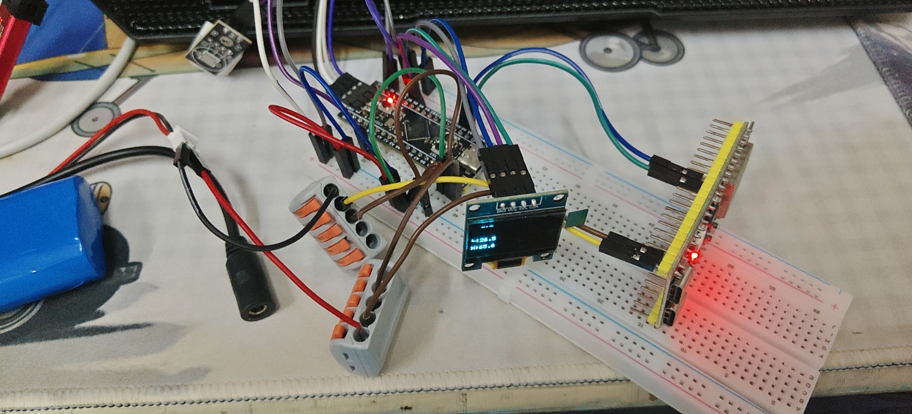
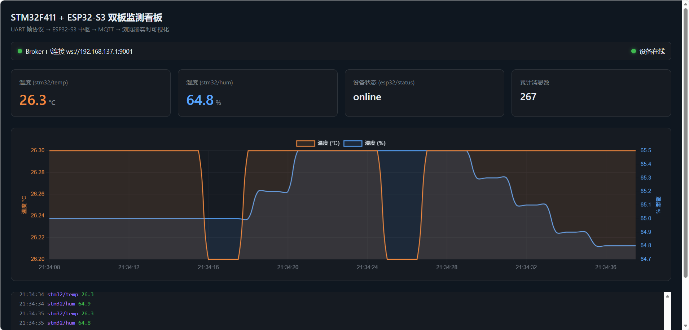
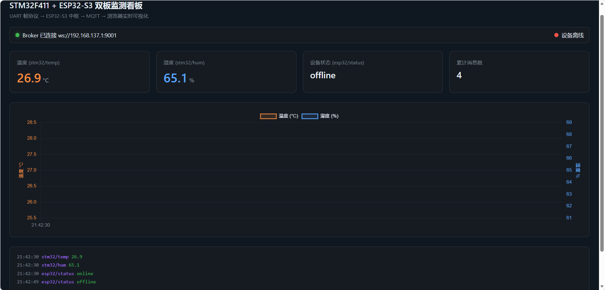
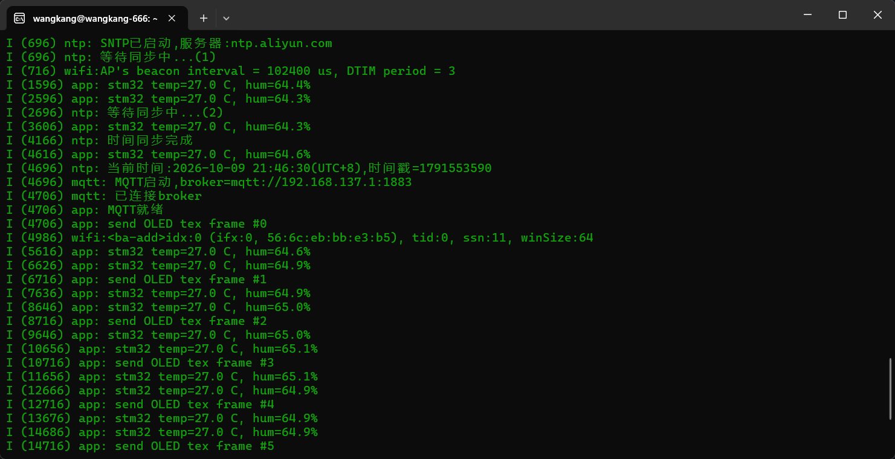

# STM32 + ESP32 双板 AIoT 数据采集系统


> 从**寄存器级驱动**到**云端可视化**的完整嵌入式实践项目。
> STM32F411 作为感知执行节点，ESP32-S3 作为网络中枢，两者通过自定义串口帧协议互联；
> 数据经 MQTT 上云，并在零后端 Web 看板上实时可视化。

---

## 📖 项目简介

本项目以"双板协作"的方式，串联起嵌入式开发的核心链路：

```
┌──────────────┐   UART 帧协议    ┌───────────────┐   MQTT/TCP    ┌──────────────┐
│  STM32F411   │◄───────────────►│   ESP32-S3    │◄─────────────►│   Mosquitto  │
│  感知执行节点  │  DMA + 环形缓冲  │   网络中枢     │  QoS1/retain  │    Broker    │
│ DHT22 / OLED │                 │ WiFi/SNTP/MQTT│               └───────┬──────┘
│ 舵机 / LED    │                 └───────┬───────┘                       │ WebSocket
└──────────────┘                         │                               ▼
                                  ┌──────┴──────┐                 ┌──────────────┐
                                  │  调试串口    │                 │  Web 看板     │
                                  │ (USB-UART)  │                 │ 实时曲线/状态  │
                                  └─────────────┘                 └──────────────┘
```

**一句话数据流**：DHT22 采集 → STM32 组帧 → UART(DMA) → ESP32 解析 → MQTT 上云 → 浏览器实时渲染。

---

## 🎯 技术亮点

| 亮点 | 说明 |
|---|---|
| **跨平台协议层** | 帧协议实现为**零依赖纯 C 模块**，"状态外置 + 返回值解耦"，同一份代码在 STM32 / ESP32 / PC **三端复用**（ESP-IDF 侧封装为独立组件） |
| **可测试性建设** | CMake + CTest 搭建 PC 侧单元测试，**12 组用例 / 35 条断言**，覆盖粘包、半包、校验错误、噪声重同步等边界；**测试中发现并修复了真实缺陷** |
| **UART DMA 接收** | 循环模式 + 半满/全满双中断 + IDLE 空闲中断 + 水位线管理，中断频率由"每字节一次"降至"每批一次" |
| **无锁环形缓冲** | 单生产者单消费者（SPSC）设计，中断与任务各持指针，无需互斥锁；2 的幂取模优化 |
| **中断轻量化** | DMA 中断仅搬运数据入环并发送号量；解析、组帧、业务全部下沉至任务层 |
| **FreeRTOS 架构** | 五任务分层，按场景选用队列 / 计数信号量 / 互斥锁 / 事件组 / 任务通知 / 软件定时器 |
| **MQTT 可靠性** | QoS1 + retain + **LWT 遗嘱消息**，实现设备在线状态自动播报（拔电后看板自动变"离线"） |
| **工程规范** | Git 版本控制 + 敏感信息分层（`sdkconfig` 本地留存 / `sdkconfig.defaults` 脱敏入库）+ `.gitattributes` 跨平台换行符规范 |

---

## 🧩 核心设计

### 1. 跨平台帧协议（`protocol/`）

帧格式：`0xAA 0x55 | LEN | CMD | PAYLOAD[0..LEN-1] | XOR-SUM`

```
字节流:  AA 55 04 01 01 2A 02 58 SUM
         └帧头┘ │  │  └─负载─┘ └校验┘
              长度 命令
```

设计要点：

- **状态机解析**（6 状态），天然处理**粘包 / 半包**
- **状态外置**：解析状态封装在 `frame_parser_t` 上下文里，支持多实例、可复位、可测试
- **返回值解耦**：解析结果用枚举返回，不依赖任何 RTOS / MCU 接口 → 三端通用
- **resync 机制**：字节流协议**无法自行区分"帧被截断"与"帧未发完"**，必须由上层注入时间信息：
  - STM32 → `USART IDLE` 空闲中断
  - ESP32 → UART 读超时
  - PC 测试 → 直接调用

```c
/* 三端共用的同一个函数签名 */
frame_result_t frame_parser_feed(frame_parser_t *p, uint8_t byte, frame_t *out);
```

### 2. UART DMA 循环接收（STM32）

```
DMA 搬运 → RingBuffer 暂存 → 状态机组帧 → 队列投递 → 任务处理
 (中断)      (无锁 SPSC)      (解析任务)    (帧传输)    (业务)
```

- DMA 配置为**循环模式**，256 字节缓冲分上下半区
- **半满中断**收割前半区、**全满中断**收割后半区、**IDLE 中断**收割尾部不足半区的数据
- 水位线（`rx_watermark`）保证数据不被重复或遗漏消费

### 3. 单元测试（`tests/`）

```bash
cmake -S tests -B tests/build && cmake --build tests/build
./tests/build/test_frame_protocol
```

覆盖场景（节选）：

| 用例 | 验证点 |
|---|---|
| 半包 | 一帧分 3 次喂入仍能正确组帧 |
| 粘包 | 连续两帧能解析出 2 帧 |
| 校验错误 | 篡改 SUM 后返回 `FRAME_ERR_CHECKSUM` 并计数 |
| 超长 LEN | 非法长度被拒绝且**不越界**，之后能恢复正常解析 |
| 噪声前缀 | 20 字节随机干扰后仍能重新锁定帧头 |
| 载荷含帧头 | 负载中的 `0xAA 0x55` 不被误判为帧头 |
| 连续帧头 | `AA AA 55` 边界不漏帧（**此处修复了一个真实缺陷**） |
| 多实例 | 两个解析器交错喂数据互不干扰 |

### 4. FreeRTOS 任务架构（STM32）

| 任务 | 优先级 | 职责 | 主要同步机制 |
|---|---|---|---|
| `parse` | 3 | 消费环形缓冲 → 协议解析 | 计数信号量 |
| `UART` | 2 | 处理下行命令（舵机/LED/OLED） | 帧队列、互斥锁 |
| `SENSOR` | 1 | 周期采集并上报温湿度 | 互斥锁、事件组、`vTaskDelayUntil` |
| `SHOW` | 1 | OLED 状态显示 | 事件组、互斥锁 |
| `HEART` | 1 | 心跳指示 | 任务通知（软件定时器驱动） |
| idle 钩子 | — | 喂独立看门狗 IWDG | — |

### 5. 数据可视化（`dashboard/`）

**零后端架构**：浏览器通过 MQTT over WebSocket 直连 broker（`mqtt.js` + `Chart.js`），无需任何中间服务。

---

## 🔧 硬件清单

| 器件 | 角色 | 说明 |
|---|---|---|
| STM32F411CEU6 | 感知执行节点 | 寄存器级开发，不依赖 HAL 库驱动 |
| ESP32-S3 | 网络中枢 | ESP-IDF v5.5 |
| DHT22 | 温湿度传感器 | 单总线时序驱动 |
| SSD1306 OLED (0.96") | 本地显示 | I2C，已从软件模拟迁移至**硬件 I2C** |
| SG90 舵机 | 执行器 | TIM3 PWM 驱动 |
| LED | 状态指示 | 心跳闪烁 |
| CH343 | USB 转串口 | ESP32 烧录（经 usbipd 透传至 WSL） |
| ST-Link | 调试器 | STM32 烧录 |

---

## 📦 项目结构

```
embedded-projects/
├── 01-test/                 STM32F411 工程（Makefile）
│   ├── main.c               任务定义与调度
│   ├── include.c/h          外设驱动（UART DMA / OLED / DHT22 / 舵机 / IWDG）
│   ├── ringbuf.c/h          无锁 SPSC 环形缓冲
│   └── FreeRTOSConfig.h     内核裁剪配置
├── 02-esp32-s3/             ESP32-S3 工程（ESP-IDF）
│   ├── main/
│   │   ├── app_main.c       应用入口与业务分发
│   │   ├── uart_link.c/h    UART 链路模块
│   │   ├── wifi_app.c/h     WiFi 连接管理（静态 IP + DNS）
│   │   ├── ntp_sync.c/h     SNTP 网络校时
│   │   └── mqtt_app.c/h     MQTT 客户端（QoS/retain/LWT）
│   └── docs/ARCHITECTURE.md 系统架构文档
├── 03-esp32-cam/            ESP32-CAM 视觉节点（骨架，规划中）
├── protocol/                ★ 三端共用的帧协议（零依赖纯 C）
│   ├── frame_protocol.c/h
│   └── CMakeLists.txt       ESP-IDF 组件描述
├── tests/                   ★ PC 侧单元测试（CMake + CTest）
│   ├── CMakeLists.txt
│   └── test_frame_protocol.c
├── dashboard/
│   └── index.html           零后端 Web 看板
└── docs/
    ├── DEPS.md              第三方依赖清单与还原步骤
    └── images/              项目展示图片
```

---

## 🚀 快速开始

### 环境要求

- STM32：`arm-none-eabi-gcc` 13.2.1+、`make`
- ESP32：ESP-IDF **v5.5**（含 xtensa 工具链）
- PC 测试：`cmake` 3.16+、`gcc`
- Broker：Mosquitto 2.x（Windows/Linux 均可）

> 完整的第三方依赖版本与还原步骤见 [`docs/DEPS.md`](docs/DEPS.md)

### ① PC 侧单元测试（无需硬件）

```bash
cd embedded-projects
cmake -S tests -B tests/build
cmake --build tests/build
./tests/build/test_frame_protocol
```

### ② STM32 端

```bash
cd 01-test
make                    # 生成 build/01-test.elf/.hex/.bin
# 使用 ST-Link 烧录 build/01-test.bin
```

### ③ ESP32-S3 端

```bash
cd 02-esp32-s3
source /path/to/esp-idf/export.sh
idf.py menuconfig       # 填写 WiFi SSID / Password（其余已在 sdkconfig.defaults 固化）
idf.py -p /dev/ttyACM0 flash monitor
```

### ④ MQTT Broker 与看板

```conf
# mosquitto.conf
listener 1883 0.0.0.0
allow_anonymous true
listener 9001
protocol websockets
```

浏览器打开 `dashboard/index.html` 即可看到实时曲线。

---

## 📡 通信协议速查

| CMD | 方向 | 载荷 | 含义 |
|---|---|---|---|
| `0x01` | STM32 → S3 | 温度×10 + 湿度×10（4B） | 温湿度上报 |
| `0x02` | STM32 → S3 | — | 心跳 |
| `0x10` | S3 → STM32 | 角度（1B） | 舵机控制 |
| `0x11` | S3 → STM32 | 0/1 | LED 开关 |
| `0x20` | S3 → STM32 | UTF-8 文本 | OLED 显示 |

MQTT 主题：

| 主题 | 方向 | 说明 |
|---|---|---|
| `stm32/temp` / `stm32/hum` | 发布 | 温湿度（retain） |
| `esp32/status` | 发布 | 在线状态（含 LWT 遗嘱） |
| `esp32/cmd` | 订阅 | 下行命令 |

---

## 📸 运行效果

### 硬件实物



<!-- 建议：双板 + DHT22 + OLED + 舵机的实拍照片 -->

### 实时数据看板



<!-- 建议：看板运行截图（温湿度双曲线 + 设备在线 + 消息日志） -->

### 设备离线演示（LWT 遗嘱消息）



<!-- 建议：拔掉板子电源 30~90 秒后的截图，右上角显示"设备离线" -->

### 现场噪声下的协议稳定性



<!-- 建议：ESP32 monitor 日志截图，展示 stm32 temp=xx.x C 正常解析 -->

---

## 📚 相关文档

| 文档 | 内容 |
|---|---|
| [`02-esp32-s3/docs/ARCHITECTURE.md`](02-esp32-s3/docs/ARCHITECTURE.md) | 系统架构：拓扑、任务模型、协议设计、内存预算、里程碑 |
| [`docs/DEPS.md`](docs/DEPS.md) | 第三方依赖清单、版本、环境还原步骤 |

---

## 🛠 技术栈

**嵌入式**：STM32F411（寄存器级）· ESP32-S3 · FreeRTOS · ESP-IDF v5.5 · DMA · I2C · SPI · PWM · UART
**协议与网络**：自定义帧协议 · TCP/IP · WiFi · MQTT · SNTP · WebSocket
**工具链**：arm-none-eabi-gcc · CMake · Make · Git · WSL · usbipd
**前端**：mqtt.js · Chart.js

---

## 🗺 Roadmap

- [x] UART DMA 循环接收 + 无锁环形缓冲
- [x] 跨平台帧协议 + PC 侧单元测试
- [x] FreeRTOS 五任务架构
- [x] SPI / 硬件 I²C 驱动实践
- [x] ESP32 WiFi / SNTP / MQTT
- [x] MQTT 实时可视化看板
- [ ] CRC-8 校验升级 + 链路质量统计上报
- [ ] ESP32-CAM 视觉节点（JPEG 采集与传输）
- [ ] I2S 音频（INMP441 麦克风 / MAX98357 功放）
- [ ] 云端大模型接入（语音/视觉问答）

---

## 📄 说明

本项目为个人学习实践项目，重点在于**底层驱动的寄存器级实现**、**协议设计的可测试性**与**RTOS 架构的合理性**。
欢迎交流指正。
